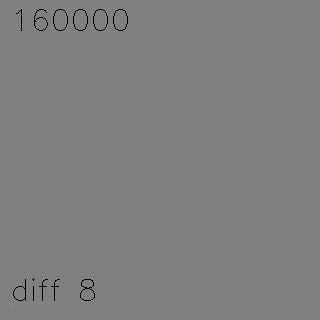
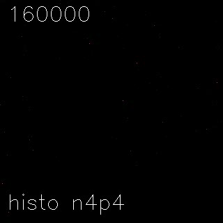

# OpenEB DVS 事件数据工具验证

## 1. 输入与结论

- 输入：`/home/astri/rk3588-sensor-studio/2026-11-17_15-22-09/dvs/events.raw`
- OpenEB：`5.2.0`，编译提交 `6b132be062c18828466846de91f8de95bbf73284`
- 文件格式：EVT21，Prophesee/GenX320MP，320x320，相机序列号 `00000374`
- 事件类型：只有 CD（Contrast Detection）事件
- 全文件事件数：`5,746,637`
- 全文件相对时长：`8.519999 s`
- 全文件平均事件率：约 `674.5 Kev/s`

结论：该文件是与 OpenEB 原生兼容的 EVT21 事件文件。格式识别、全量解码、裁剪、CSV/HDF5/DAT 转换、事件视频和事件帧生成均成功。

## 2. 目录说明

```text
.
├── README.md
├── csv/
│   └── events_0_1s.csv
├── dat/
│   ├── events_0_1s_cd.dat
│   └── events_0_1s_trigger.dat
├── event_frames/
│   ├── events_0_1s_diff.raw
│   ├── events_0_1s_diff.avi
│   ├── events_0_1s_histo.raw
│   ├── events_0_1s_histo.avi
│   └── *.png
├── hdf5/
│   └── events_0_1s.hdf5
├── logs/
│   └── *.txt
├── raw_samples/
│   ├── events_0_1s.raw
│   └── events_0_1s.raw.tmp_index
└── video/
    ├── events_0_1s.avi
    └── events_0_1s_first_frame.png
```

目录总大小约 `37 MB`。

## 3. 工具调用方法

以下命令均使用实际执行时的绝对路径。

```bash
BIN=/home/astri/openeb/build/bin
SRC=/home/astri/rk3588-sensor-studio/2026-11-17_15-22-09/dvs/events.raw
OUT=/home/astri/openeb_events_analysis_2026-11-17_15-22-09
```

### 3.1 查看文件信息

```bash
$BIN/metavision_file_info -i "$SRC"
```

- `-i/--input-event-file`：输入 RAW、DAT 或 HDF5 事件文件。
- 用途：识别文件格式、传感器、分辨率、事件类型、事件数量和时间范围。
- 默认行为：RAW 时间戳相对首事件附近显示，便于直接得到持续时间和事件率。

保留设备绝对时间：

```bash
$BIN/metavision_file_info -d -i "$SRC"
```

- `-d/--disable-timestamp-shifting`：关闭时间戳平移。
- 本文件绝对事件时间范围是 `27.720013..36.239999 s`。

注意：使用 `-d` 时，输出的 `Duration` 字段是最后一个绝对时间戳，而不是末时间减首时间。实际持续时间为 `8.519986 s`。

### 3.2 裁剪 0-1 秒片段

```bash
$BIN/metavision_file_cutter \
  -i "$SRC" \
  -o "$OUT/raw_samples/events_0_1s.raw" \
  -s 0 \
  -e 1
```

- `-i/--input-event-file`：输入事件文件。
- `-o/--output-file`：裁剪后的 RAW 文件。
- `-s/--start`：起始偏移，单位秒，相对于文件开头。
- `-e/--end`：结束偏移，单位秒。

结果仍是标准 EVT21 文件，可再次交给 OpenEB 使用。由于事件是离散的，裁剪结果是约 `995.585 ms`，不是恰好 1000 ms。

### 3.3 转换为 CSV

```bash
$BIN/metavision_file_to_csv \
  -i "$OUT/raw_samples/events_0_1s.raw" \
  -o "$OUT/csv/events_0_1s.csv"
```

- `-i/--input-event-file`：输入事件文件。
- `-o/--output-file`：CD 事件 CSV 输出路径。

CSV 无表头，每行格式为：

```text
x,y,p,t
```

- `x,y`：像素坐标。
- `p`：`1` 为 ON 事件，`0` 为 OFF 事件。
- `t`：事件时间戳，单位微秒。

本次 1 秒片段统计：

```text
events=163055
x_min=0
x_max=319
y_min=0
y_max=319
p_0_OFF=73370
p_1_ON=89685
t_first_us=13
t_last_us=995585
duration_us=995572
average_rate_events_per_s=163780.219
```

这里的 `163.8 Kev/s` 只是首秒片段的统计，不代表完整 8.52 秒文件的平均事件率。全文件平均值为约 `674.5 Kev/s`。

### 3.4 转换为 HDF5

```bash
$BIN/metavision_file_to_hdf5 \
  -i "$OUT/raw_samples/events_0_1s.raw" \
  -o "$OUT/hdf5/events_0_1s.hdf5"
```

- `-i/--input-path`：输入事件文件或目录。
- `-o/--output-path`：输出的 HDF5 路径。
- 用途：适合 Python `h5py`、数据分析或需要结构化数据集和索引的场景。

生成文件可被 `metavision_file_info` 重新读取，事件数仍为 `163055`。主要结构：

```text
/CD/events        shape=(163055,), compound(x:u16, y:u16, p:i16, t:i64)
/CD/indexes       shape=(499,), compound(id:u64, ts:i64)
/EXT_TRIGGER/events
/EXT_TRIGGER/indexes
```

本文件没有 trigger 事件，因此 `EXT_TRIGGER` 数据集为空。

### 3.5 转换为 DAT

```bash
$BIN/metavision_file_to_dat -i "$OUT/raw_samples/events_0_1s.raw"
```

- `-i/--input-event-file`：输入 RAW 或 HDF5。
- 该工具没有输出参数；会自动生成 `事件文件名_cd.dat` 和 `事件文件名_trigger.dat`。

本次将两个文件整理到 `dat/`：

```text
events_0_1s_cd.dat       1,304,512 bytes，163055 个 CD 事件
events_0_1s_trigger.dat  0 bytes，没有 trigger 事件
```

CD DAT 可被 `metavision_file_info` 重新识别，事件数量和时间范围与 CSV/HDF5 一致。

### 3.6 生成普通事件视频

```bash
$BIN/metavision_file_to_video \
  -i "$OUT/raw_samples/events_0_1s.raw" \
  -o "$OUT/video/events_0_1s.avi" \
  -a 10000 \
  -s 1
```

- `-i/--input-event-file`：输入事件文件。
- `-o/--output-video-file`：AVI 输出路径。
- `-a/--accumulation-time`：每个显示帧累积事件的时间，单位微秒；`10000` 表示 10 ms。
- `-s/--slow-motion-factor`：生成帧率相对于固定 30 fps 播放帧率的倍率；`1` 表示 30 fps 生成。

输出为 `320x320`、MJPG、30 fps、30 帧、1 秒 AVI。

提取的第一帧：

```text
video/events_0_1s_first_frame.png
```

### 3.7 生成 Diff 和 Histo 事件帧

Diff：

```bash
$BIN/metavision_event_frame_generation \
  -i "$OUT/raw_samples/events_0_1s.raw" \
  -o "$OUT/event_frames/events_0_1s_diff.raw" \
  -v "$OUT/event_frames/events_0_1s_diff.avi" \
  -p 10000 \
  --diff \
  --no-display
```

Histo：

```bash
$BIN/metavision_event_frame_generation \
  -i "$OUT/raw_samples/events_0_1s.raw" \
  -o "$OUT/event_frames/events_0_1s_histo.raw" \
  -v "$OUT/event_frames/events_0_1s_histo.avi" \
  -p 10000 \
  --histo \
  --no-display
```

- `-o/--output-file`：事件帧二进制 RAW 输出。
- `-v/--output-video`：可视化 AVI 输出。
- `-p/--period`：按时间周期生成帧，单位微秒；`10000` 表示每 10 ms 一帧。
- `--diff`：按 ON/OFF 极性累加差值。
- `--histo`：分别统计 ON/OFF 事件数形成直方图帧。
- `--no-display`：禁用交互窗口，适合无桌面的 shell 环境。

两种 RAW 的文本头分别为 `DIFF3D` 和 `HISTO3D`，几何尺寸均为 `320x320`。约 1 秒输入生成 99 个 10 ms 时间片。

由于 AVI 播放固定为 30 fps，而事件帧以约 100 Hz 生成，所以 AVI 是 99 帧、约 3.3 秒，属于慢放结果。

0.5 秒附近的 Diff 与 Histo 样例帧：





## 4. 数据含义和注意事项

- `events.raw` 是原始异步事件流，不是传统帧视频；每个事件只有坐标、极性和微秒时间戳。
- CSV 适合快速检查和小规模分析；完整文件转 CSV 会显著增大体积。
- HDF5 保留了事件数组及索引，更适合程序化分析与随机访问。
- DAT 是紧凑的事件交换格式，本次 CD 数据为 1,304,512 字节，trigger 文件为空。
- `file_to_video` 生成便于预览的事件累积视频，不改变原始事件文件。
- Diff/Histo 是算法派生数据，不是 EVT21；不能把 `DIFF3D/HISTO3D` 文件当作普通 EVT21 再次解析。
- `events.raw.tmp_index` 是 OpenEB 为加速读取生成的索引缓存，不是事件数据。
- 交互式 `metavision_viewer`、`metavision_filtering`、`metavision_time_surface` 等依赖图形界面，本目录未在无显示环境中启动它们；本次使用的非交互工具已覆盖格式、格式转换和基础事件帧处理链路。

## 5. 校验材料

- `logs/01_file_info_relative.txt`：全文件相对时间统计。
- `logs/02_file_info_absolute.txt`：全文件绝对时间统计。
- `logs/04_file_info_cut.txt`：裁剪片段的格式和事件数校验。
- `logs/11_csv_summary.txt`：CSV 坐标、极性、时间和事件率统计。
- `logs/12_file_info_hdf5.txt`：HDF5 回读校验。
- `logs/13_file_info_dat.txt`：DAT 回读校验。
- `logs/16_hdf5_structure.txt`：HDF5 数据集结构。
- `logs/20_sha256.txt`：输入及主要输出的 SHA-256。
